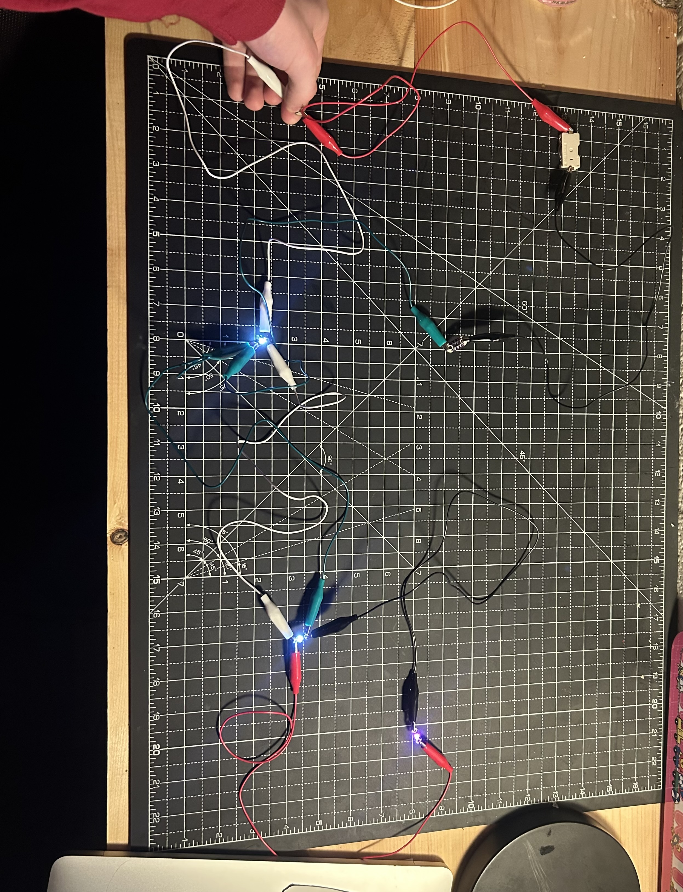

This project was a practice of using arrays to keep track of multiple variables of a similar type, in this case output pins and their state. We had to randomly pick a number and then alter both arrays such that if the light on the randomly selected pin was on, it would turn off, and vice versa. This was achieved by having the randomly selected pin have a state variable at the same spot in the array as its corresponding pin. 

